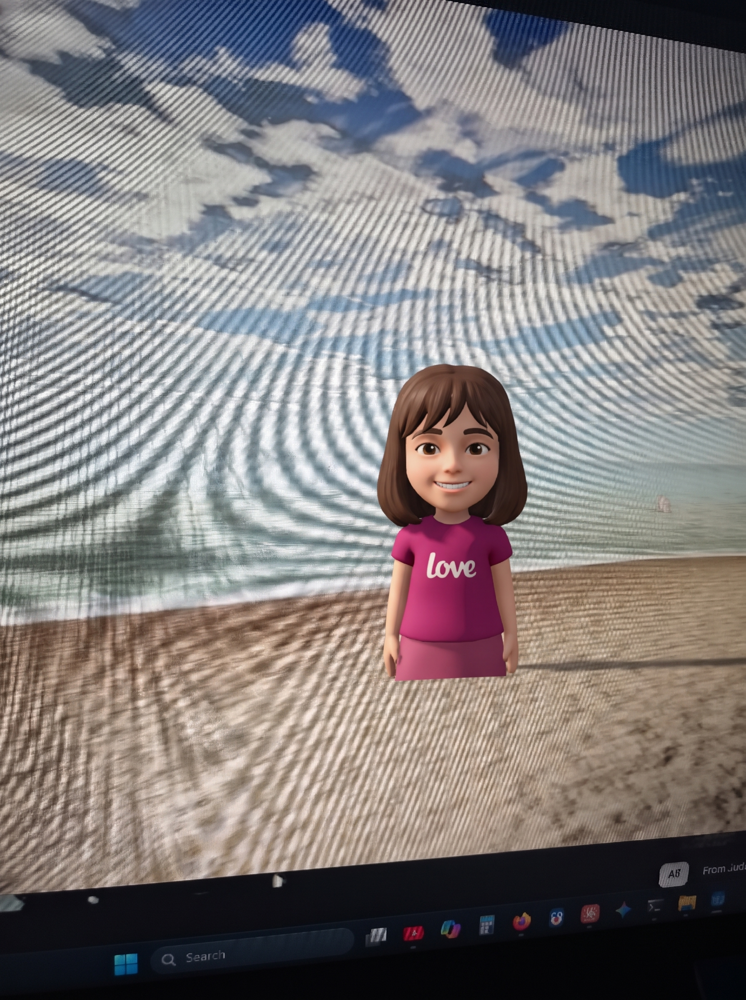

# Claire on the Sea 🏝️🧜‍♀️

**Claire on the Sea** é um projeto feito pela **Maria Clara com o papai**. 💛

É um jogo 3D de exploração numa ilha tropical. A Claire anda pela praia, sobe as colinas de capim, mergulha no mar azul, nada ao lado de tubarões mansos e procura conchas escondidas. Lá longe, no fundo do oceano, também há um segredo esperando para ser encontrado...

Quase tudo no jogo é feito por código: a ilha, o mar, o céu com nuvens, as palmeiras, os bichos, as casas e até os sons. Não há arquivos de áudio nem de cenário.



---

## O que tem no jogo

- **Uma ilha tropical** com praia, colinas de capim, palmeiras, pedras e arbustos, além de uma ilhota pequena ali perto.
- **Um píer de madeira** entrando no mar e um guarda-sol na praia onde a Claire começa.
- **Uma cabana estilo "Lagoa Azul"** perto do meio da ilha. Ela fica sobre palafitas, tem paredes de taquara e telhado de folhas de palmeira. Tem também varanda com rede e, dentro, cama de bambu, mesa de toco e cocos.
- **20 conchas para coletar**, marcadas por fachos de luz. Cada uma toca um sininho.
- **O mar** com ondas, maré, espuma e mergulho. Embaixo d'água há corais, algas e cardumes de peixes coloridos.
- **Tubarões mansos** de 7 espécies, que só estão passeando.
- **Gaivotas** voando sobre a ilha.
- **Um segredo no fundo do mar** (veja abaixo, se quiser estragar a surpresa 😉).

## Controles

| Tecla | O que faz |
|---|---|
| **W A S D** | andar / nadar |
| **Mouse** | olhar em volta |
| **Shift** | correr / nadar mais rápido |
| **Espaço** | pular (na água: subir) |
| **Ctrl** | mergulhar |
| **Roda do mouse** | aproximar ou afastar a câmera |
| **Esc** | soltar o mouse |
| **F11** | tela cheia |
| **'** (abaixo do Esc) ou **F1** | abrir e fechar o console |

Debaixo d'água a Claire boia devagar para cima. Para ficar lá embaixo, segure **Ctrl**.

## O console

Aperte **'** para abrir o console e digite os comandos com ou sem a barra (`/ajuda` ou `ajuda`). Para fechar, aperte **'** ou **Esc**.

| Comando | O que faz |
|---|---|
| `/ajuda` | lista os comandos |
| `/status [mundo\|claire\|conchas\|tubaroes\|bichos\|cenario]` | mostra detalhes do mundo |
| `/tp inicio \| pier \| ilhota \| centro \| casa` | leva a Claire para um lugar |
| `/tp <x> <z>` ou `/tp concha [n]` ou `/tp tubarao [espécie]` | leva a Claire para uma posição, concha ou tubarão |
| `/criar tubarao <espécie> [n] \| concha [n] \| gaivota [n] \| cardume [n]` | cria coisas perto da Claire |
| `/remover tubaroes \| conchas \| gaivotas \| peixes \| tudo` | tira coisas do mundo |
| `/coletar [n \| todas]` | coleta conchas |
| `/velocidade [claire\|tubaroes] <mult>` | deixa mais rápido ou mais devagar |
| `/pulo <mult>` | pulo mais alto |
| `/voar` | liga ou desliga o voo |
| `/sol <elevação> [direção]` | muda a posição do sol (0 = pôr do sol) |
| `/mare <metros>` | muda o nível do mar |
| `/nevoa <mult>` | muda a névoa (0 = sem névoa) |
| `/tempo <escala>` | câmera lenta ou acelerada |
| `/limpar` | limpa o console |
| `/reiniciar` | recomeça o mundo do zero |

<details>
<summary><b>🧜‍♀️ O segredo do fundo do mar (spoiler!)</b></summary>

Bem longe da ilha, a uns 250 metros, mora uma **sereia** com cabelo ruivo, coroa dourada e cauda de escamas. Ao lado dela nada um **peixinho-palhaço**, que nunca a deixa sozinha.

Ela vive numa **mansão de conchas** no fundo do mar. A mansão tem cúpulas de madrepérola, torres em espiral e um pórtico de colunas. Dá para entrar nadando:

- no **salão**, com o trono de vieira e o lustre de pérolas;
- no **quarto**, com a cama de concha gigante;
- na **sala do tesouro**, cheia de moedas de ouro.

A cada partida a mansão aparece num **lugar diferente**. A única pista é uma **coluna de bolhas** que sobe da torre até a superfície.

Quando a Claire chega perto da sereia, toca um canto especial e aparece na tela: **"Você encontrou a sereia!!!"**

(Para ir direto até ela: `/tp sereia` no console.)

</details>

## Como jogar

### No Windows

Basta abrir o **`ClaireOnTheSea.exe`**. É um arquivo único, sem instalação.

### Pelo Godot

1. Instale o [Godot 4.7](https://godotengine.org/) (versão padrão, não a .NET).
2. Abra o Godot, clique em **Importar** e escolha o arquivo `project.godot` desta pasta.
3. Aperte **F5** para jogar.

### Gerando o .exe

Com os modelos de exportação do Godot 4.7 instalados:

```sh
godot --headless --path . --export-release "Windows Desktop" build/ClaireOnTheSea.exe
```

## Como o projeto é organizado

```
world/      a ilha, o mar, o céu, os bichos, as casas e os sons
  world.gd          monta o mundo inteiro e cuida dos eventos
  terrain.gd        o formato da ilha e do fundo do mar
  props.gd          palmeiras, pedras, píer, guarda-sol...
  hut.gd            a cabana "Lagoa Azul"
  sharks.gd         os tubarões
  wildlife.gd       gaivotas e cardumes
  shell.gd          as conchas
  mermaid.gd        a sereia e o peixinho
  mermaid_house.gd  a mansão da sereia
  audio_gen.gd      todos os sons, gerados por código
  *.gdshader        água, céu, capim, folhas, tubarões, cauda da sereia
player/     a Claire: movimento, câmera e o modelo 3D
ui/         a tela (contador de conchas, mensagens) e o console
tools/      ferramentas e tentativas antigas guardadas como referência
```

## Créditos

- **Feito por:** Maria Clara e o papai 💛 (com ajuda do Claude na programação)
- **Modelo da Claire e da sereia:** [Mini Characters](https://kenney.nl/assets/mini-characters), de **Kenney** (licença CC0), recolorido por código.
- **Motor:** [Godot Engine](https://godotengine.org/)
